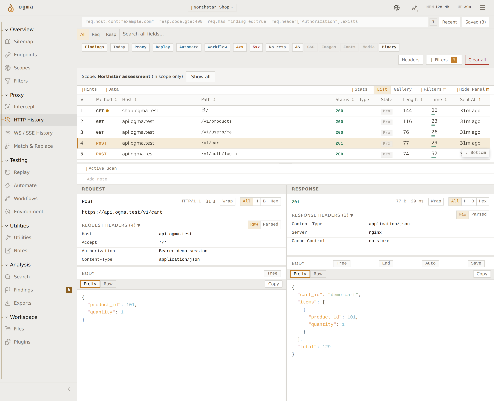

# Ogma

Ogma is an intercepting proxy for testing web applications and APIs. Capture traffic, change a request, send it again, and keep your notes and findings with the project.

It runs on Windows, macOS, and Linux, with a Rust backend, Vue interface, and Electron desktop app.

**[Download Ogma](https://ogmabox.com/download)** · [Try it in your browser](https://ogmabox.com/) · [Documentation](https://docs.ogmabox.com/) · [Discord](https://discord.gg/QNSadmjh6y)

<picture>
  <source media="(prefers-color-scheme: dark)" srcset="assets/http-history-dark.png">
  
</picture>

*HTTP History in the website demo, using sample traffic. [Try the interactive workspace](https://ogmabox.com/) before downloading.*

## Working with Ogma

HTTP History is a starting point. Search the traffic with HTTPQL, send a request to Replay, and compare what happens when you change it. Related requests stay together in collections, and each attempt keeps its request and response.

There are tools for the rest of an assessment too:

- Pause and edit HTTP or WebSocket messages in Intercept, or apply Match & Replace rules as traffic passes through.
- Test payload lists with Automate, build request pipelines in Replay, and reuse processing steps through workflows.
- Inspect MessagePack and SignalR messages, import API definitions, and use Sitemap and content discovery to explore a target.
- Run passive and active checks, record findings with supporting traffic, and export reports.
- Add JavaScript plugins with the [SDK](https://github.com/ogmabox/ogma-sdk), use the built-in AI assistant with your configured provider, or connect an agent through MCP.

The [features page](https://ogmabox.com/features) has interactive examples. The [documentation](https://docs.ogmabox.com/) covers setup and the individual tools.

## Downloads

Get the current version from the [download page](https://ogmabox.com/download) or [GitHub Releases](https://github.com/ogmabox/ogma/releases/latest).

| System | Architecture | Downloads |
| --- | --- | --- |
| Windows | x64, ARM64 | Installer or portable `.exe` |
| macOS | Apple Silicon, Intel | `.dmg` or `.zip` |
| Linux | x64 | `.AppImage` or `.deb` |
| Linux | ARM64 | `.AppImage` |

[Older releases](https://github.com/ogmabox/ogma/releases) and the [changelog](https://docs.ogmabox.com/changelog) are available if you need a previous version or want to see what changed.

## First capture

1. Install Ogma and open a project or temporary session.
2. Start a proxy instance, then open its workspace.
3. Open Ogma Browser, which is already configured to use the proxy, and browse your test application.
4. Open **HTTP History** to inspect the requests and responses. Send a request to **Replay** when you want to work on it separately.

For an external browser, use the listener address shown in Ogma, normally `127.0.0.1:8080`. For HTTPS inspection, download the CA from **Settings > Certificate** and trust it in the browser profile used for testing. The [first-capture guide](https://docs.ogmabox.com/guide/first-capture) walks through both options.

## About this repository

This repository hosts releases and tracks issues. It does not contain the desktop application's source code.

Found a bug? [Open an issue](https://github.com/ogmabox/ogma/issues/new) with your Ogma version, operating system, and steps to reproduce it. Feature requests are welcome there too. For questions or a less formal conversation, join [Discord](https://discord.gg/QNSadmjh6y).
